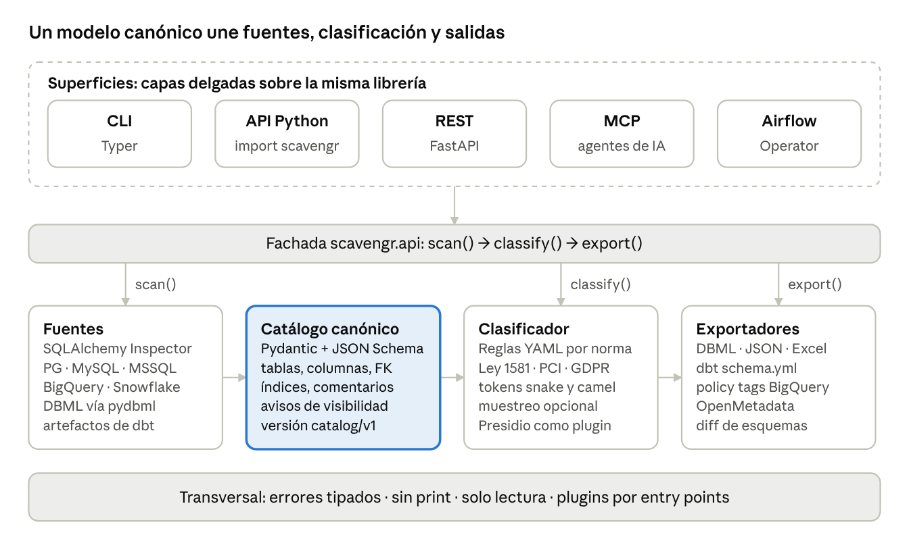
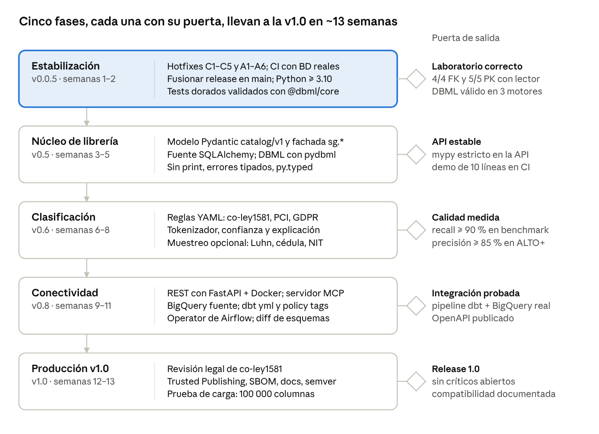

# Scavengr: auditoría técnica y camino a la v1.0

6 oct 2026 · @JasRockr

> Documento con fecha: las cifras y el estado del código son los del 6 oct 2026, sobre `release/v0.0.4`. El avance desde entonces está en el [CHANGELOG](../../CHANGELOG.md).

Hoy Scavengr no sirve como dependencia de otros proyectos. La estructura por capas es buena, pero lo central falla en casos comunes y lo hace en silencio: no extrae bien los metadatos ni clasifica bien qué columnas son sensibles. Mi plan es dejar en manos de SQLAlchemy la lectura de esquemas y en pydbml el manejo del DBML, y concentrarme en lo que es propio del proyecto: clasificar según la Ley 1581, generar diccionarios en español y conectarse con las herramientas de datos. Con eso estimo llegar a una v1.0 (librería, REST y MCP) en unas 10–13 semanas de trabajo enfocado.

## Resultados

Monté un laboratorio con un esquema realista. Scavengr acertó 1 de 4 llaves foráneas y marcó como sensibles solo el 27 % de las columnas con datos personales. La misma base leída con SQLAlchemy dio 4 de 4.

| Prueba (rama `release/v0.0.4`) | Resultado | Esperado |
| --- | --- | --- |
| FK en PostgreSQL (usuario dueño) | 1 de 4 bien: 1 con el esquema equivocado, 2 falsas por producto cartesiano y 1 que no aparece | 4 de 4 |
| PK/FK con un usuario de solo lectura (los permisos que recomienda el README) | 0 PK y 0 FK, y aun así `success=True` | 5 PK, 4 FK |
| Columnas que llegan al diccionario | 30 de 33: se pierden `FechaNacimiento`, `numeroDocumento` y `correoElectronico` | 33 de 33 |
| DBML válido para `@dbml/core` (el parser oficial) | PostgreSQL: inválido. MySQL: válido, pero con columnas de índice equivocadas | Válido y fiel |
| Columnas con datos personales detectadas (55 nombres) | 27 % (15 de 55) | ≥ 90 % |
| `DB_PORT=5433` por CLI o `.env` | Se ignora y conecta al 5432 | 5433 |
| `--env-file` explícito | Lo pisa `~/.scavengr.env` | Gana el archivo explícito |
| Tests | 278 de 283 pasan, 75 % de cobertura, ninguno contra una base real | Integración con bases reales en CI |
| SQLAlchemy Inspector sobre el mismo laboratorio | 4/4 FK y 5/5 PK, también con el usuario de solo lectura, en 0,03 s | — |

El 90 % de detección es un objetivo que puse yo: `email`, `telefono` o `numero_documento` deberían quedar por lo menos en ALTO.

## Qué revisé

El código vigente está en `release/v0.0.4` (9 commits, el último del 19 nov 2025), no en `main`, que sigue en v0.0.3 aunque PyPI ya publica 0.0.4.post1.

- **Código:** las dos ramas completas. Me baso en `release/v0.0.4`, porque `main` quedó 3 commits atrás y sin tests.
- **Laboratorio PostgreSQL 16:** tres esquemas (`public`, `ventas`, `rrhh`), la tabla `clientes` repetida en dos de ellos, una FK compuesta, una FK entre esquemas, columnas camelCase, un índice por expresión, una tabla particionada, una vista, comentarios y un rol `lector` de solo lectura.
- **Laboratorio MariaDB 10.11:** FK simple, índice compuesto no único y `varchar`/`decimal` con longitud.
- **Validación externa:** pasé el DBML generado por `@dbml/core` 3, el parser de dbdiagram.io.
- **Clasificador:** 55 nombres de columna típicos de Colombia y Latinoamérica, en español e inglés, snake\_case y camelCase, más 7 nombres no sensibles para medir falsos positivos.
- **Calidad:** pytest con cobertura, flake8, mypy y bandit.
- **Sin probar en vivo:** SQL Server, porque no tenía una instancia. Lo que digo de SQL Server sale de leer el código.

## Lo que funciona y se queda

La idea está bien planteada; lo que falla es la ejecución.

- **Capas separadas:** `core` (entidades y servicios), `application` (casos de uso), `infrastructure` (adaptadores) e interfaces. Es justo la estructura que necesita una librería.
- **Casos de uso que devuelven resultados** (`ExtractionResult`, `ValidationResult`…) en vez de imprimir y salir. Sobre eso se construye la API.
- **Enfoque en la regulación local:** las categorías de la Ley 1581 y el vocabulario en español son lo que distingue a Scavengr de las herramientas en inglés.
- **Diccionario Excel de 19 campos:** descripción, regex, máscara, ejemplos y módulo. Un equipo de gobierno de datos lo puede usar tal cual.
- **Escáner de SQL Server** que sí tiene en cuenta el esquema en las FK (`referenced_schema`), a diferencia del de PostgreSQL.
- **Base del proyecto:** 283 tests, documentación con mkdocs, CHANGELOG, pre-commit, publicación en PyPI y caché de metadatos con vencimiento.

## Hallazgos

Cinco fallos son críticos: dan resultados incorrectos y aun así reportan éxito. Todos, menos los de SQL Server, los reproduje en el laboratorio.

| ID | Severidad | Hallazgo | Evidencia | Archivo |
| --- | --- | --- | --- | --- |
| C1 | Crítica | Se ignoran el puerto y el driver: la configuración entrega `port`/`driver`, pero los conectores leen `DB_PORT`/`DB_DRIVER` | Con `DB_PORT=5433` se conecta al 5432. En SQL Server nunca se usan ni el puerto ni `DB_DRIVER` | `connector.py` |
| C2 | Crítica | Las FK de PostgreSQL salen de `constraint_column_usage`, sin esquema ni orden de columnas | La FK compuesta genera 2 referencias falsas a `items.linea`. `rrhh.empleados` apunta a `public.clientes` (la real es `rrhh.clientes`). Falta `ventas.pedidos` → `public.clientes` | `scanners.py` |
| C3 | Crítica | Con un usuario de solo lectura no aparecen PK ni FK: `information_schema` oculta las restricciones de tablas que no son suyas | Rol `lector` con SELECT: 0 PK y 0 FK, con `success=True` y sin advertencia | `scanners.py` |
| C4 | Crítica | El parser de DBML, hecho con regex, descarta las columnas entre comillas, que el mismo formateador genera para camelCase | Se pierden 3 de 33 columnas, justo las de datos personales | `dbml_parser.py` |
| C5 | Crítica | Al clasificador le faltan términos, no separa camelCase ni abreviaturas y coincide con fragmentos cortos | `email`, `telefono`, `nombre`, `numero_documento` y `salario` quedan en BAJO. `tarjeta_credito` y `cvv` en MEDIO. `fe`, `genero_producto` e `ips_count` en CRÍTICO | `services.py` |
| A1 | Alta | Un `--env-file` explícito pierde contra `~/.scavengr.env`: todos se cargan con `override=True` y el global va de último | El host que queda es el del archivo global. Riesgo de escanear otra base, por ejemplo producción | `env_config.py` |
| A2 | Alta | Los índices se asocian por nombre de tabla, sin esquema | `rrhh.clientes` recibe `clientes_email_key` de `public.clientes`, y eso invalida el DBML | `extract.py`, `dbml_formatter.py` |
| A3 | Alta | El índice por expresión sale vacío. En MySQL las columnas de los índices salen mal, todos quedan como `unique` y se pierden longitudes y precisiones | `()` en PostgreSQL. `(id, estado)` en vez de `(cliente_id, estado)`. `varchar` sin `(255)` | `scanners.py`, `extract.py` |
| A4 | Alta | `validate` aprueba DBML que el parser oficial rechaza | 0 errores propios contra 2 de `@dbml/core` en el mismo archivo | `validate.py` |
| A5 | Alta | Entre un paso y otro se pasa un archivo DBML: se pierde información y obliga a trabajar con rutas | `dictionary` y `report` solo aceptan rutas. Se pierden valores por defecto, comentarios e índices | `application/*` |
| A6 | Alta | La cadena de conexión ODBC no se escapa y no hay opciones de cifrado | Un `;` en la contraseña rompe la conexión o mete atributos. Faltan `Encrypt`/`TrustServerCertificate`, y ODBC 18 cifra por defecto | `connector.py` |
| M1 | Media | No se comporta como librería: imprime con `print()`, lanza `Exception` genérica y fija versiones exactas de dependencias | 671 caracteres a la consola solo al importar y cargar la configuración. `python-dotenv==1.1` y `openpyxl==3.1` generan conflictos | Varios, `pyproject.toml` |
| M2 | Media | No lee todos los objetos: ignora `COMMENT ON`, la tabla particionada padre y las vistas | Falta `public.eventos` y su partición `eventos_2026` aparece como si fuera una tabla | `scanners.py` |
| M3 | Media | La clave de la caché no incluye puerto ni usuario, y por defecto usa pickle en el directorio actual | Dos instancias en el mismo host comparten caché | `metadata_cache.py` |
| M4 | Media | Orden del repositorio: release sin fusionar a `main`, sin CI y con tests que dependen del entorno | 5 tests fallan (sin pyodbc o ejecutando como root). 523 avisos de flake8. Todos los tests usan mocks. Declara Python 3.8, que ya no tiene soporte | Repo |
| M5 | Media | El clasificador de módulos no mira el esquema | `rrhh.clientes` queda como CRM | `services.py` |

## Qué construyo y qué delego

No tiene sentido mantener SQL de catálogo propio para cada motor ni un parser de DBML con regex: ahí están casi todos los fallos críticos y ya existen librerías maduras que lo resuelven. Lo que aporta Scavengr es la clasificación y la documentación.

| Componente | Decisión | Con qué | Por qué |
| --- | --- | --- | --- |
| Lectura de esquemas | Delegar | [SQLAlchemy 2.x Inspector](https://docs.sqlalchemy.org/en/20/core/reflection.html) (`get_multi_columns`, `get_multi_foreign_keys`…) | En el laboratorio resolvió FK compuestas, FK entre esquemas, comentarios, índices por expresión y particiones, también con el usuario de solo lectura. Soporta PostgreSQL, MySQL/MariaDB, SQL Server, Oracle y SQLite, y con paquetes de terceros BigQuery y Snowflake |
| Extras por motor | Construir, lo mínimo | SQL nativo solo para procedimientos, triggers y estadísticas de filas y tamaño | Inspector no los cubre y son opcionales |
| DBML (leer y escribir) | Delegar | [pydbml](https://pypi.org/project/pydbml) (1.2.1, oct 2025), con `@dbml/core` en CI como validador | Elimina de raíz C4, A2, A3 y A4 |
| Modelo de datos interno | Construir | Pydantic v2 + JSON Schema con versión (`scavengr.catalog/v1`) | Es el formato público de la librería, la API REST y las integraciones, y reemplaza al DBML entre pasos |
| Clasificación de sensibilidad | Construir (lo propio del proyecto) | Reglas en archivos YAML (Ley 1581, PCI DSS, GDPR) + muestreo opcional de valores | Vocabulario en español, documentos locales (cédula, NIT con dígito de verificación) y categorías de la Ley 1581 |
| Datos personales en texto libre | Plugin opcional | [Presidio](https://github.com/microsoft/presidio) | Para columnas `text` y `jsonb` con contenido libre |
| Diccionario y reporte | Conservar y adaptar | Los generadores actuales, sobre el nuevo modelo | Es lo que ya funciona |
| Catálogo y linaje a gran escala | No competir | Exportar a OpenMetadata o DataHub | Son plataformas completas; Scavengr las alimenta |

La herramienta más parecida en Python, [piicatcher](https://github.com/tokern/piicatcher), no saca versiones desde julio de 2023. No hay hoy un escáner de metadatos que clasifique datos personales en español y se pueda usar como librería.

## Arquitectura objetivo



Todas las formas de uso llaman a la misma API. Entre pasos solo viaja el catálogo v1, así que una fuente o un exportador nuevo no toca el clasificador.

## Cómo se va a usar: librería, REST y MCP

Las tres comparten el mismo modelo, `scavengr.catalog/v1`. La CLI, el servidor REST y el servidor MCP son capas delgadas sobre la misma librería.

### Librería (lo que importa otro proyecto)

```python
import scavengr as sg

catalog = sg.scan(
    "postgresql+psycopg://lector@db:5432/erp",  # URL o Engine de SQLAlchemy
    schemas=["ventas", "rrhh"],
    include={"views", "comments"},
)
result = sg.classify(catalog, rules=["co-ley1581", "pci"],
                     sampling=sg.Sampling(enabled=False))

for f in result.findings(min_level="ALTO"):
    print(f.fqn, f.level, f.category, f.confidence, f.reasons)

result.export("xlsx", "diccionario.xlsx")
result.export("dbml", "erp.dbml")
result.export("dbt", "models/")      # schema.yml con meta y policy tags
payload = catalog.model_dump_json()   # formato con versión
```

Para que sea una buena dependencia:

- **Sin efectos secundarios:** nada de `print`, logger con `NullHandler` y ningún archivo escrito fuera de `export()`.
- **Errores tipados:** `ScavengrError` → `ConnectionFailed`, `InsufficientPrivileges`, `InvalidDBML`, `UnsupportedSource`.
- **Si no se ve todo, se avisa:** va en `catalog.warnings`; nunca un éxito silencioso (evita C3).
- **Empaquetado:** `py.typed`, versionado semántico desde la 1.0 y dependencias con rangos, no versiones fijas.
- **Extras opcionales:** `scavengr[postgres|mysql|mssql|bigquery|server|mcp|presidio]`.
- **Extensible con entry points:** `scavengr.sources`, `scavengr.rules` y `scavengr.exporters`.

### REST (`scavengr[server]`, FastAPI)

| Método | Ruta | Uso |
| --- | --- | --- |
| POST | `/v1/scans` | Inicia un escaneo asíncrono con `connection_ref` (el nombre de un secreto, nunca la contraseña en el cuerpo) → 202 + id |
| GET | `/v1/scans/{id}` | Estado y avance |
| GET | `/v1/scans/{id}/catalog` | Catálogo en JSON |
| GET | `/v1/scans/{id}/findings?min_level=ALTO` | Columnas sensibles encontradas |
| GET | `/v1/scans/{id}/exports/{format}` | `dbml`, `xlsx`, `json`, `dbt` |
| POST | `/v1/classify` | Clasifica un catálogo o un DBML, sin credenciales |
| POST | `/v1/validate` | Valida un DBML |
| POST | `/v1/diff` | Compara dos catálogos (cambios de esquema) |
| GET | `/v1/rules` | Reglas disponibles |
| GET | `/healthz`, `/readyz` | Chequeos de salud para Cloud Run o Kubernetes |

Autenticación por API key o IAM de Cloud Run. Las credenciales de las bases salen de Secret Manager o de variables de entorno del servicio.

### MCP (`scavengr[mcp]`)

Un servidor MCP de solo lectura con `scan_database`, `find_sensitive_columns`, `describe_table` y `export_dictionary`. Sirve para que un agente responda, por ejemplo, "¿qué columnas con datos personales tiene `rrhh`?" sin acceso directo a la base.

## Integraciones

Las que más aportan son BigQuery como fuente y dbt como destino de la clasificación: así la sensibilidad viaja con el modelo y termina en controles de acceso por columna.

| Integración | Qué hace | Entregable | Prioridad |
| --- | --- | --- | --- |
| BigQuery (fuente) | Escanea datasets, incluidos campos anidados `STRUCT`/`ARRAY` con `INFORMATION_SCHEMA.COLUMN_FIELD_PATHS` | Adaptador `bigquery` (nativo o [sqlalchemy-bigquery](https://pypi.org/project/sqlalchemy-bigquery)) | Alta |
| dbt (destino) | Escribe o actualiza `schema.yml` con `meta.sensitivity` y `meta.categoria_1581` por columna y, en BigQuery, `policy_tags` | Exportador `dbt` + modo `--check` para CI, que falla si aparece una columna sensible sin etiquetar | Alta |
| dbt (fuente) | Clasifica desde `manifest.json`/`catalog.json` sin conectarse a la base | Adaptador `dbt-artifacts` | Alta |
| BigQuery policy tags / Dataplex | Etiqueta las columnas ALTO y CRÍTICO para restringir el acceso por columna | Comando `apply-tags`, con `--dry-run` por defecto | Media |
| Airflow | Escaneo programado con las Connections que ya existen y alerta de cambios (columna sensible nueva, FK eliminada) | `ScavengrScanOperator` + DAG de ejemplo | Media |
| dlt | Clasifica el esquema que dlt infiere antes de cargar, para decidir qué columnas cifrar u omitir | Función `classify_dlt_schema(pipeline)` | Media |
| Calidad de datos | Convierte en tests la regex, la nulabilidad y la unicidad inferidas | Tests de dbt (`not_null`, `unique`, `accepted_values`, regex) | Media |
| OpenMetadata / DataHub | Publica las etiquetas en un catálogo corporativo | Exportadores opcionales | Baja |

## Roadmap por fases

Son 10 a 13 semanas de trabajo enfocado; a tiempo parcial, el doble. Empiezo por estabilizar porque hoy la herramienta entrega resultados incorrectos marcados como éxito.



Ninguna fase empieza sin pasar la puerta de la anterior. Como el primer caso de uso son pipelines con BigQuery, dbt y Airflow, la Conectividad arranca por BigQuery y dbt, y REST y MCP van después.

## Arreglos inmediatos (0.0.5)

Caben en una semana y quitan los resultados incorrectos más graves mientras avanza la reescritura. Cada uno lleva un test de integración contra el laboratorio.

- [ ] **C1** `connector.py`: leer `config.get("port") or config.get("DB_PORT")` (igual con `driver`) y añadir el puerto en SQL Server (`SERVER=host,port`).
- [ ] **A1** `env_config.py`: un `--env-file` explícito es exclusivo (solo ese archivo más las variables del proceso). Sin él, el orden es variables del proceso > `.env.local` > `.env` > `~/.scavengr.env`. Mostrar qué archivo se cargó.
- [ ] **C2 + C3** `scanners.py`: leer PK y FK de PostgreSQL desde `pg_constraint`, no desde `information_schema`. La consulta de abajo, probada con el rol `lector`, devolvió las 4 FK correctas, la compuesta con sus columnas en orden.
- [ ] **C4** `dbml_parser.py`: aceptar nombres y tipos entre comillas, o adelantar el cambio a pydbml.
- [ ] **A2** `extract.py`, `dbml_formatter.py`: asociar índices y FK por `(schema, table)`, nunca solo por el nombre de la tabla.
- [ ] **A3**: escribir los índices por expresión con backticks (DBML los admite: ``(`lower(estado)`)``). En MySQL, corregir el orden de los campos de los índices (`is_unique` en 3, columnas en 4) y usar `COLUMN_TYPE` en lugar de `DATA_TYPE`.
- [ ] **C5 (parcial)** `services.py`: separar camelCase y PascalCase; agregar `email`, `correo`, `telefono`, `celular`, `nombre(s)`, `apellido(s)`, `direccion`, `documento`, `identificacion`, `salario` y `sueldo`; subir tarjetas y CVV a CRÍTICO; exigir la palabra completa en patrones de 2–3 letras (`fe`, `ips`).
- [ ] **A6** `connector.py`: escapar los valores ODBC entre llaves (`PWD={...}`, duplicando `}`) y exponer `encrypt` y `trust_server_certificate`.
- [ ] **M1** `pyproject.toml`: `python-dotenv>=1.0,<2`, `openpyxl>=3.1,<4`, `requires-python>=3.10`.
- [ ] **M4**: fusionar `release/v0.0.4` en `main`; CI en GitHub Actions con pytest en Python 3.10–3.13 y PostgreSQL, MySQL y SQL Server; corregir los 5 tests que dependen del entorno; tests dorados que validen cada DBML con `@dbml/core`.

```sql
-- PK/FK visibles para cualquier usuario con CONNECT, con esquema y orden de columnas
SELECT c.conname,
       ns.nspname  AS schema_name, cl.relname  AS table_name, a.attname  AS column_name,
       rns.nspname AS ref_schema,  rcl.relname AS ref_table,  ra.attname AS ref_column,
       k.ord       AS position
FROM pg_constraint c
JOIN pg_class cl      ON cl.oid = c.conrelid
JOIN pg_namespace ns  ON ns.oid = cl.relnamespace
JOIN pg_class rcl     ON rcl.oid = c.confrelid
JOIN pg_namespace rns ON rns.oid = rcl.relnamespace
CROSS JOIN LATERAL unnest(c.conkey, c.confkey) WITH ORDINALITY AS k(att, ref_att, ord)
JOIN pg_attribute a  ON a.attrelid = c.conrelid  AND a.attnum = k.att
JOIN pg_attribute ra ON ra.attrelid = c.confrelid AND ra.attnum = k.ref_att
WHERE c.contype = 'f'
  AND ns.nspname NOT IN ('pg_catalog', 'information_schema')
ORDER BY 2, 3, 1, k.ord;
```

## Riesgos

El riesgo más grande es legal, no técnico: hoy la herramienta cita mal la ley que dice aplicar.

| Riesgo | Qué hago |
| --- | --- |
| Las etiquetas dicen "Datos Privados (Art. 6 Ley 1581)" y "Semiprivados (Art. 6)". El Art. 6 trata de los datos sensibles, y la Ley 1581 no define privado, semiprivado ni público ([texto de la ley](https://normativa.colpensiones.gov.co/colpens/compilacion/docs/ley_1581_2012.htm)); esa clasificación viene de la Ley 1266 de 2008 | Que un abogado o el oficial de protección de datos revise las reglas `co-ley1581` antes de la 1.0, y presentar el resultado como sugerencia, no como dictamen |
| El muestreo de valores toca datos reales y necesita SELECT sobre las tablas, no solo sobre el catálogo | Apagado por defecto; nunca guardar ni registrar valores, solo conteos y patrones; límite de filas y `statement_timeout` |
| Reescribir la extracción rompe a quien ya usa la CLI | Mantener comandos y flags; las rutas de import viejas avisan con `DeprecationWarning` durante dos versiones menores |
| Una columna sensible que no se detecta da una falsa sensación de cumplimiento | En CI, mínimo 90 % de detección sobre un benchmark etiquetado, y el campo `confidence` visible en todas las salidas |
| Escanear con credenciales que pueden escribir | Transacción de solo lectura (`SET TRANSACTION READ ONLY`) y aviso si el usuario tiene permisos de escritura |

## Decisiones de diseño

Primero validar con un caso de uso real, con licencia Apache-2.0 y manteniendo pyodbc para SQL Server. Las tres decisiones priorizan la confianza sobre el alcance.

| Pregunta | Decisión | Por qué | Lo que descarté |
| --- | --- | --- | --- |
| ¿Empezar por un caso de uso real o por lo más visible? | Pipelines de datos con BigQuery, dbt y Airflow primero, con el repo abierto desde el día uno | Un uso real obliga a arreglar lo que importa y deja un caso documentado. Montar REST o MCP sobre algo que acierta 1 de 4 FK solo multiplica el error | Sacar primero REST o MCP para ganar visibilidad: atrae curiosos, pero la primera impresión sería la de una herramienta que falla |
| ¿MIT u otra licencia? | Apache-2.0 para la librería y las reglas. Las versiones ya publicadas siguen en MIT | Es igual de permisiva y además cede patentes de forma explícita, lo que facilita que una empresa la apruebe como dependencia. Las reglas tienen que poder revisarse para que alguien confíe en ellas | AGPL para el servidor (protege contra la reventa como servicio, pero frena a las empresas); BSL (demasiado control para un proyecto que todavía necesita usuarios) |
| ¿Driver de SQL Server? | pyodbc vía SQLAlchemy por defecto; pymssql como extra `scavengr[mssql-lite]` | pyodbc es el que soporta Microsoft (ODBC 18, cifrado, Entra ID). SQL Server domina en banca, cooperativas y retail en Latinoamérica. La imagen Docker trae el driver instalado | pymssql como único driver (pierde la autenticación corporativa). El driver `mssql-python` de Microsoft lo dejo en observación hasta que madure |

Ningún dato ni nombre de esquema real entra al repositorio ni al benchmark: el laboratorio y los fixtures son sintéticos.

## Fuentes

- [JasRockr/Scavengr](https://github.com/JasRockr/Scavengr): ramas `main` y `release/v0.0.4`, clonadas el 6 oct 2026
- [scavengr en PyPI](https://pypi.org/project/scavengr/): versión publicada 0.0.4.post1
- [SQLAlchemy 2.0: reflexión con Inspector](https://docs.sqlalchemy.org/en/20/core/reflection.html)
- [pydbml en PyPI](https://pypi.org/project/pydbml)
- [piicatcher](https://github.com/tokern/piicatcher) y [su historial en PyPI](https://pypi.org/project/piicatcher/0.20.1/)
- [Microsoft Presidio](https://github.com/microsoft/presidio)
- [PostgreSQL: vista `table_constraints`](https://www.postgresql.org/docs/19/infoschema-table-constraints.html): solo muestra restricciones de tablas propias o con privilegios distintos de SELECT
- [Ley 1581 de 2012 (texto compilado)](https://normativa.colpensiones.gov.co/colpens/compilacion/docs/ley_1581_2012.htm)
