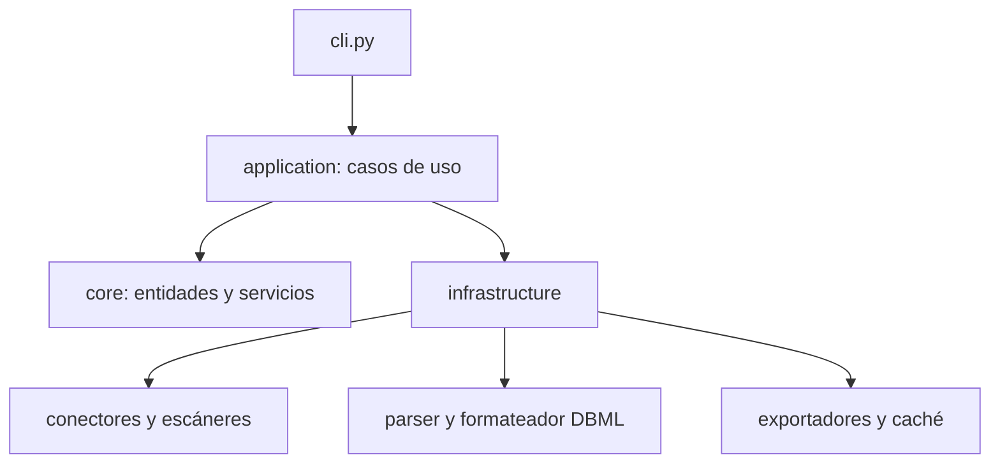

# Scavengr

> _"Descubre lo que tus bases esconden."_

Scavengr es una herramienta de línea de comandos que lee los metadatos de una base de datos (PostgreSQL, MySQL/MariaDB o SQL Server) y genera un archivo DBML, un diccionario de datos con la sensibilidad de cada columna y un informe de calidad del esquema.

```bash
pip install "scavengr[postgres]"
scavengr init
scavengr extract -o esquema.dbml
scavengr validate -i esquema.dbml
scavengr dictionary -i esquema.dbml -o diccionario.xlsx
scavengr report -i esquema.dbml -o informe.xlsx
```

!!! warning "Proyecto en alfa"
    En octubre de 2026 una auditoría técnica encontró fallos que dan resultados incorrectos sin avisar: puertos ignorados, llaves foráneas mal armadas en PostgreSQL y columnas que se pierden entre pasos, entre otros. Los estoy corrigiendo en la 0.0.5. La lista está en el [README](https://github.com/JasRockr/Scavengr#estado-del-proyecto) y el detalle en la [auditoría](https://github.com/JasRockr/Scavengr/blob/main/docs/auditoria-tecnica/README.md).

## Guías

- [Instalación](guide/installation.md)
- [Configuración](guide/configuration.md)
- [Comandos](guide/commands.md)
- [Referencia de la API](api/core/entities.md), generada desde los docstrings
- [Cómo contribuir](contributing.md)

## Arquitectura



- **core:** entidades del esquema, interfaces y servicios (clasificación de sensibilidad, descripciones, máscaras, ejemplos).
- **application:** un caso de uso por comando (`extract`, `validate`, `dictionary`, `report`), cada uno devuelve un resultado en vez de imprimir.
- **infrastructure:** conexión y lectura de cada motor, caché de metadatos, parser y formateador DBML y escritura de Excel, CSV y JSON.
- **cli.py:** la línea de comandos.

## Licencia

MIT. Ver [LICENSE](https://github.com/JasRockr/Scavengr/blob/main/LICENSE).
